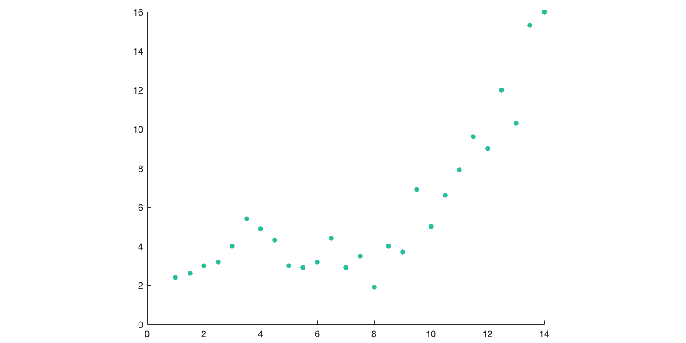
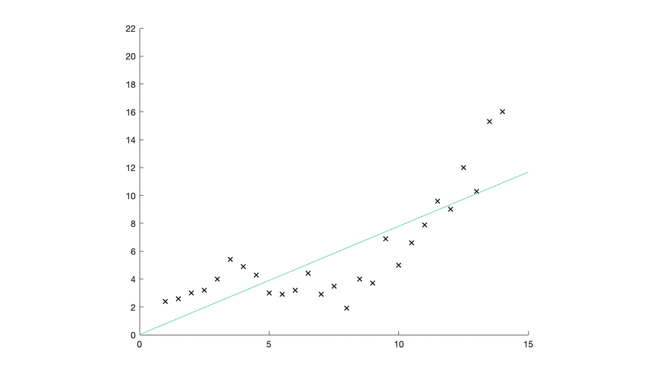

# polynomial-regression

Model generator based on the method of least squares. Zero dependencies, ships
both ESM and CommonJS builds with TypeScript type declarations.

## Installation

```bash
npm install polynomial-regression
```

## Usage

There is a single entry point, the **`createModel`** function.

Once we have created our model we can fit it by feeding it with data and
specifying the desired degree/s of our resulting model/s.

The API is designed so that a single model can hold several fits at once, keyed
by degree. Instead of a fixed estimation function, coefficients for each degree
are stored internally, so we can compare which degree suits our problem best by
calling `estimate` with different degrees.

Let's illustrate its usage with a simple example. We are given some data points,
stored as an array of `[x, y]` tuples:

```javascript
const data = [
  [1, 2.4],
  [1.5, 2.6],
  [2, 3],
  [2.5, 3.2] /* ... */,
];
```



We want a model that lets us interpolate or estimate unknown values from this
information. In this example we use a low degree (3) and a higher one (20):

```javascript
import { createModel } from 'polynomial-regression';
// CommonJS: const { createModel } = require('polynomial-regression');

const model = createModel();

model.fit(data, [3, 20]);

model.estimate(3, unknownXValue);
model.estimate(20, unknownXValue);
```



### Reusable expressions

`expressions()` turns the fitted coefficients into plottable strings you can
copy & paste into graphing tools:

```javascript
const expressions = model.expressions();
// {
//   "3":  "+1.5062596662599177*x^0+1.425302045761659*x^1 ...",
//   "20": "+66.40442892021944*x^0-204.3486735913864*x^1 ..."
// }
```

### Persisting and restoring a fit

Fitting can be expensive, so you can serialize a model's coefficients and
rehydrate later without refitting. `toJSON()` returns a plain, deep-copied
object (and is picked up automatically by `JSON.stringify`); pass those
coefficients to `createModel` to restore:

```javascript
import { writeFileSync, readFileSync } from 'node:fs';

// Save — persistence is left to you, so any storage works.
writeFileSync('./coefficients.json', JSON.stringify(model));

// Restore later, no refitting required.
const restored = createModel(JSON.parse(readFileSync('./coefficients.json', 'utf8')));
restored.estimate(3, unknownXValue);
```

## API Reference

| Method        | Description                                                                                     | Arguments                                         | Returns                    |
| ------------- | ----------------------------------------------------------------------------------------------- | ------------------------------------------------- | -------------------------- |
| `createModel` | Create a model, optionally rehydrated from previously fitted coefficients keyed by degree       | `initialParams?` `Record<number, number[]>`       | `Model`                    |
| `fit`         | Calculate coefficients for each degree provided and store them internally (merged across calls) | `data` `[number, number][]`, `degrees` `number[]` | `void`                     |
| `estimate`    | Return the estimated value, or `undefined` if the degree has not been fitted                    | `degree` `number`, `x` `number`                   | `number \| undefined`      |
| `expressions` | Turn the current coefficients into reusable expression strings                                  | none                                              | `Record<number, string>`   |
| `toJSON`      | Return a deep copy of the current coefficients keyed by degree (also used by `JSON.stringify`)  | none                                              | `Record<number, number[]>` |

## Migrating from v2

See [CHANGELOG.md](CHANGELOG.md). In short: `saveParams()` → `toJSON()`,
`loadParams(obj)` → `createModel(obj)`, and `saveExpressions()` → `expressions()`.
